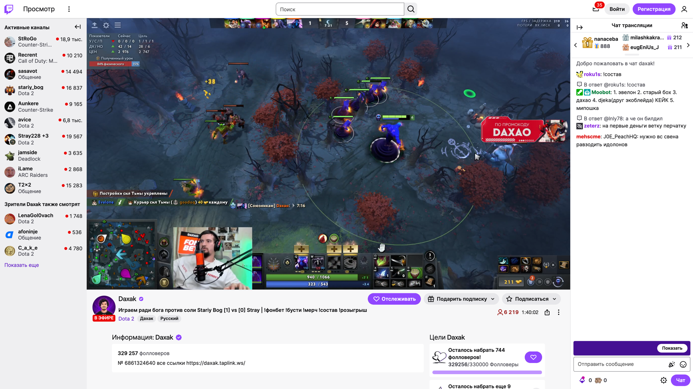
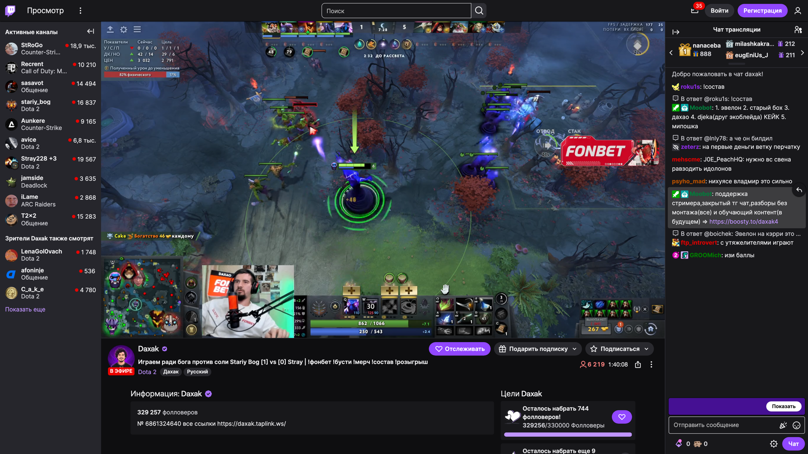
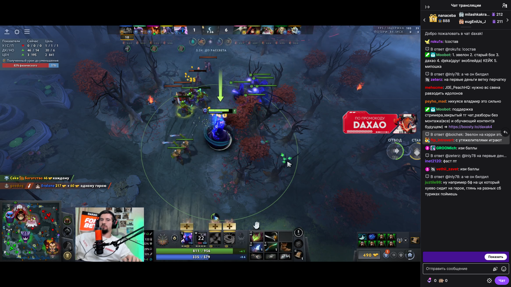

# Twitch Auto Theme

Расширение для браузеров на Chromium (Chrome, Brave, Edge): тема Twitch
следует оформлению системы — светлая днём, тёмная ночью, — а в режиме
кинотеатра страница всегда полностью тёмная.

## Как выглядит

| Светлая тема | Тёмная тема |
| --- | --- |
|  |  |

Кинотеатр (Alt+T) всегда полностью тёмный — даже когда в системе светлая тема:

## Что делает

- При загрузке любой страницы Twitch тема ставится по системной настройке
  (оформление macOS или Windows) — сразу, без мигания.
- Если системная тема меняется, пока вкладка Twitch открыта, тема
  переключается на лету: без перезагрузки страницы, без кнопок и без входа
  в аккаунт.
- Кинотеатр (Alt+T) — всегда тёмный, включая чат; при выходе возвращается
  системная тема.
- Никаких разрешений браузера не запрашивает: работает только на twitch.tv.

## Установка (Chrome / Brave / Edge)

1. Скачайте репозиторий: кнопка **Code → Download ZIP**, либо
   `git clone https://github.com/maksimryzhov614/twitch-auto-theme`.
2. Откройте `chrome://extensions` (в Brave — `brave://extensions`).
3. Включите «Режим разработчика» (переключатель справа сверху).
4. Нажмите «Загрузить распакованное расширение» и выберите папку с файлами.
5. Откройте вкладку Twitch и обновите её один раз.

## Проверка

1. Смените оформление системы — открытая вкладка Twitch поменяет тему за
   пару секунд.
2. Нажмите Alt+T — кинотеатр полностью тёмный; ещё раз Alt+T — вернулась
   тема системы.
3. Ключ темы в консоли (F12): `localStorage.getItem('twilight.theme')` —
   `1` тёмная, `0` светлая.

## Как устроено (для разработчика)

- Тема Twitch хранится в `localStorage['twilight.theme']`: `1` — тёмная,
  `0` — светлая. Ключ пишется на `document_start`, поэтому Twitch стартует
  сразу с нужной темой. Дополнительно ключ согласовывается при каждом цикле
  проверки — на случай, если событие смены системной темы потерялось.
- Смена темы «на лету»: цвета на странице собраны из CSS-переменных. Темы
  различаются ровно 180 переменными — они сняты с живой сборки Twitch
  и лежат в `vars.js`. Расширение:
  1. переставляет классы `tw-root--theme-dark` / `tw-root--theme-light`
     на `<html>` и на обёртках;
  2. инлайново задаёт 180 различающихся переменных на `<html>` и на
     элементах-обёртках, чья таблица переменных зеркалит тему страницы
     (styled-components-правила вида `.X.X`).
- Обёртки со «своей» палитрой (например, оверлеи плеера) не трогаются: их
  значения одинаковые в обеих темах, и в естественно светлой, и в естественно
  тёмной загрузке они выглядят одинаково.
- Кинотеатр определяется по `.persistent-player--theatre`. Если страница
  отрисована светлой, расширение само ставит тёмные переменные и классы; если
  тёмной — снимает светлые следы переключения. В обоих случаях страница
  и чат полностью тёмные, а после выхода возвращается системная тема.
- Если Twitch перерисует страницу, наблюдатель за DOM повторит правки;
  при совпадении системной темы с темой страницы правки не ставятся вовсе.

## Что проверено

End-to-end в headless Brave с установленным расширением, 17.10.2026
(анонимная сессия, эмуляция системной темы, 39 проверок — все пройдены):

- старт страницы в теме системы (ключ, класс, фон, без инлайновых правок);
- живая смена системной темы в обе стороны без перезагрузки: ключ, класс,
  фон, чат и инлайновые правки меняются согласованно; при возврате к теме
  страницы правки полностью снимаются, состояние совпадает с исходным;
- живое переключение численно совпадает с естественной загрузкой страницы
  в той же теме (наборы фонов и вычисленных переменных идентичны);
- кинотеатр из светлой страницы при тёмной системе и из тёмной при светлой:
  страница и чат полностью тёмные, светлые классы и правки не остаются;
  после выхода системная тема возвращается;
- без исключений в JS.

Дополнительно на живой странице: обёртки-«зеркала» (3 элемента) перебиваются,
обёртки с особой палитрой (14 элементов) не трогаются.

## Отключение и удаление

- Пауза: переключатель расширения на странице `brave://extensions`.
- Удаление: там же кнопка «Удалить», либо удалить папку:
  `rm -rf "twitch-auto-theme"`.

## Лицензия

MIT — берите, меняйте и распространяйте свободно. Подробности в `LICENSE`.
